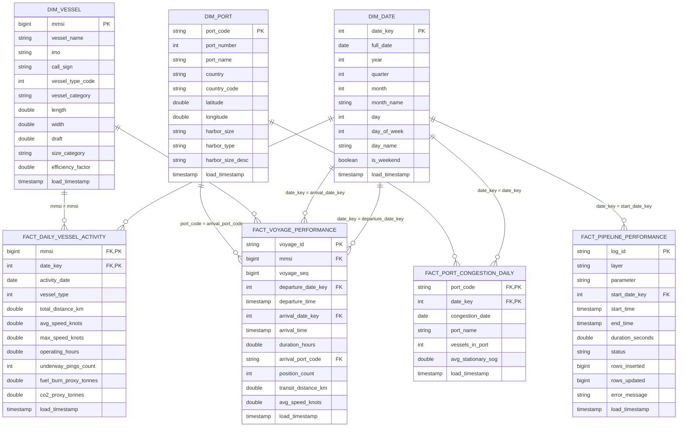

# Gold Layer Dimensional Data Modeling & Data Dictionary

## 1. Executive Summary & Modeling Strategy

The Gold layer serves as the curated business intelligence and analytical serving layer of the Maritime Medallion Lakehouse. Unlike the Silver layer—which enforces entity-level conformed schemas and event-grain facts (`fact_vessel_position`) across 1.98M individual GPS telemetry broadcasts—the Gold layer is architected as a dimensional Star Schema optimized specifically for analytical queries, aggregation throughput, and direct Power BI / Tableau semantic modeling.

### Core Architectural Decisions:
- **Star Schema Design**: Strict separation between analytical Dimensions (`dim_date`, `dim_vessel`, `dim_port`) and business event Facts (`fact_daily_vessel_activity`, `fact_port_congestion_daily`, `fact_voyage_performance`, `fact_pipeline_performance`).
- **Conformed Role-Playing Dimensions**: `dim_date` serves as a universal calendar dimension linked to departure, arrival, activity, and pipeline execution dates.
- **Physical Optimization**: Delta Lake `OPTIMIZE` and `Z-ORDER BY` applied to high-cardinality foreign keys (`mmsi`, `date_key`, `port_code`) to maximize Parquet file compaction and predicate pushdown (data skipping).
- **Direct Semantic Integration**: Foreign key relationships align directly with Power BI 1-to-many (`1:*`) directional filtering relationships.

---

## 2. Entity-Relationship (ER) Diagram

---

## 3. Detailed Data Dictionary

### 3.1 Dimension Tables

#### Table: `workspace.gold.dim_date`
- **Purpose**: Conformed time dimension supporting standard maritime fiscal and temporal drilldowns.
- **Grain**: One record per calendar day.
- **Primary Key**: `date_key` (Format: `YYYYMMDD`).
- **Optimization**: Delta Z-Order by `date_key`.

| Column | Data Type | Nullable | Definition / Business Rule | Example |
| :--- | :--- | :--- | :--- | :--- |
| `date_key` | `INT` | No | Surrogate integer key formatted as `YYYYMMDD` | `20240115` |
| `full_date` | `DATE` | No | Calendar date | `2024-01-15` |
| `year` | `INT` | No | Calendar year | `2024` |
| `quarter` | `INT` | No | Calendar quarter (1 to 4) | `1` |
| `month` | `INT` | No | Month of year (1 to 12) | `1` |
| `month_name` | `STRING` | No | Full month name | `"January"` |
| `day` | `INT` | No | Day of month (1 to 31) | `15` |
| `day_of_week` | `INT` | No | Day of week integer (1 = Sunday, 7 = Saturday) | `2` |
| `day_name` | `STRING` | No | Full day of week name | `"Monday"` |
| `is_weekend` | `BOOLEAN` | No | Boolean flag indicating Saturday or Sunday | `false` |
| `load_timestamp`| `TIMESTAMP`| No | UTC execution timestamp of dimension build | `2026-10-25 15:30:00` |

---

#### Table: `workspace.gold.dim_vessel`
- **Purpose**: Conformed vessel reference dimension enriched with operational classifications, Admiralty efficiency factors, and physical size bands.
- **Grain**: One record per unique Maritime Mobile Service Identity (`mmsi`).
- **Primary Key**: `mmsi`.
- **Optimization**: Delta Z-Order by `mmsi`.

| Column | Data Type | Nullable | Definition / Business Rule | Example |
| :--- | :--- | :--- | :--- | :--- |
| `mmsi` | `BIGINT` | No | 9-digit unique Maritime Mobile Service Identity | `367123456` |
| `vessel_name` | `STRING` | Yes | Cleaned and trimmed vessel name broadcast | `"EAGLE TEXAS"` |
| `imo` | `STRING` | Yes | International Maritime Organization registration | `"9412345"` |
| `call_sign` | `STRING` | Yes | Radio call sign | `"WDD1234"` |
| `vessel_type_code`| `INT` | Yes | Numerical AIS vessel type code (0–99) | `80` |
| `vessel_category`| `STRING` | No | High-level categorization (Tanker, Cargo, Passenger, Fishing/Towing, High Speed Craft, Special Craft, Other) | `"Tanker"` |
| `length` | `DOUBLE` | Yes | Overall vessel length in meters | `249.5` |
| `width` | `DOUBLE` | Yes | Maximum beam/width in meters | `44.0` |
| `draft` | `DOUBLE` | Yes | Maximum static draught in meters | `14.2` |
| `size_category` | `STRING` | No | Physical size classification band (`Ultra Large`, `Large`, `Medium`, `Small`) | `"Large (200-299m)"` |
| `efficiency_factor`| `DOUBLE`| No | Fuel burn coefficient derived from Admiralty naval architecture tables | `1.4` |
| `load_timestamp`| `TIMESTAMP`| No | UTC execution timestamp | `2026-10-25 15:30:00` |

---

#### Table: `workspace.gold.dim_port`
- **Purpose**: Conformed maritime port and terminal infrastructure reference dimension derived from National Geospatial-Intelligence Agency (NGA) Pub 150 World Port Index.
- **Grain**: One record per unique port terminal (`port_code`).
- **Primary Key**: `port_code` (UN/LOCODE or `WPI_<portNumber>`).
- **Optimization**: Delta Z-Order by `port_code`.

| Column | Data Type | Nullable | Definition / Business Rule | Example |
| :--- | :--- | :--- | :--- | :--- |
| `port_code` | `STRING` | No | Standardized UN/LOCODE or WPI fallback identifier | `"USGAL"` |
| `port_number` | `INT` | Yes | World Port Index serial index number | `22340` |
| `port_name` | `STRING` | Yes | Standardized English port facility name | `"Galveston"` |
| `country` | `STRING` | Yes | Host country name | `"United States"` |
| `country_code` | `STRING` | Yes | ISO 2-letter country code | `"US"` |
| `latitude` | `DOUBLE` | Yes | Decimal latitude in WGS-84 coordinate system | `29.3089` |
| `longitude` | `DOUBLE` | Yes | Decimal longitude in WGS-84 coordinate system | `-94.7972` |
| `harbor_size` | `STRING` | Yes | WPI physical size code (`L`, `M`, `S`, `V`) | `"L"` |
| `harbor_type` | `STRING` | Yes | WPI harbor coastal configuration type code | `"CN"` |
| `harbor_size_desc`| `STRING`| No | Human-readable harbor size classification | `"Large Harbor"` |
| `load_timestamp`| `TIMESTAMP`| No | UTC execution timestamp | `2026-10-25 15:30:00` |

---

### 3.2 Fact Tables

#### Table: `workspace.gold.fact_daily_vessel_activity`
- **Purpose**: Daily aggregated operational vessel telemetry, distance traversed, average and peak velocities, operating duration, and Admiralty-proxy environmental emissions.
- **Grain**: One record per vessel (`mmsi`) per calendar day (`date_key`).
- **Primary Key**: Composite `(mmsi, date_key)`.
- **Foreign Keys**: `mmsi` -> `dim_vessel.mmsi`, `date_key` -> `dim_date.date_key`.
- **Optimization**: Delta Z-Order by `(mmsi, date_key)`.

| Column | Data Type | Nullable | Definition / Business Metric | Unit / Example |
| :--- | :--- | :--- | :--- | :--- |
| `activity_date` | `DATE` | No | Calendar date of activity | `2024-01-15` |
| `date_key` | `INT` | No | Foreign key linking to `dim_date.date_key` | `20240115` |
| `mmsi` | `BIGINT` | No | Foreign key linking to `dim_vessel.mmsi` | `367123456` |
| `vessel_type` | `INT` | Yes | Numerical AIS vessel type code | `80` |
| `total_distance_km`| `DOUBLE` | No | Sum of Haversine point-to-point distance traversed | `142.85 km` |
| `avg_speed_knots` | `DOUBLE` | Yes | Mean Speed Over Ground during movement | `12.40 knots` |
| `max_speed_knots` | `DOUBLE` | Yes | Peak recorded Speed Over Ground | `16.80 knots` |
| `operating_hours` | `DOUBLE` | No | Accumulated transit time with SOG >= 0.5 knots | `11.50 hours` |
| `underway_pings_count`| `INT` | No | Total AIS position messages received | `284` |
| `fuel_burn_proxy_tonnes`| `DOUBLE`| No | Modeled fuel consumption using Admiralty Cube Law: $C \cdot (L/100)^2 \cdot (V/V_{design})^3 \cdot \Delta t$ | `8.412 tonnes` |
| `co2_proxy_tonnes`| `DOUBLE`| No | Modeled CO2 emissions: $\text{fuel} \times 3.114\text{ t CO}_2/\text{t fuel}$ | `26.195 tonnes` |
| `load_timestamp`| `TIMESTAMP`| No | UTC execution timestamp | `2026-10-25 15:30:00` |

---

#### Table: `workspace.gold.fact_port_congestion_daily`
- **Purpose**: Daily terminal-level vessel queueing, anchorage dwell proxy, and congestion density metrics.
- **Grain**: One record per port facility (`port_code`) per calendar day (`date_key`).
- **Primary Key**: Composite `(port_code, date_key)`.
- **Foreign Keys**: `port_code` -> `dim_port.port_code`, `date_key` -> `dim_date.date_key`.
- **Optimization**: Delta Z-Order by `(port_code, date_key)`.

| Column | Data Type | Nullable | Definition / Business Metric | Unit / Example |
| :--- | :--- | :--- | :--- | :--- |
| `congestion_date` | `DATE` | No | Calendar date of congestion measurement | `2024-01-15` |
| `date_key` | `INT` | No | Foreign key linking to `dim_date.date_key` | `20240115` |
| `port_code` | `STRING` | No | Foreign key linking to `dim_port.port_code` | `"USGAL"` |
| `port_name` | `STRING` | Yes | Standardized port name | `"Galveston"` |
| `vessels_in_port` | `INT` | No | Count of distinct stationary vessels within 15 km port radius | `14` |
| `avg_stationary_sog`| `DOUBLE`| Yes | Average residual speed of queued vessels | `0.22 knots` |
| `load_timestamp`| `TIMESTAMP`| No | UTC execution timestamp | `2026-10-25 15:30:00` |

---

#### Table: `workspace.gold.fact_voyage_performance`
- **Purpose**: Voyage-level transit analytics tracking end-to-end journey duration, departure/arrival timestamps, and terminal turnaround.
- **Grain**: One record per segmented vessel voyage (`voyage_id`).
- **Primary Key**: `voyage_id` (`<mmsi>_<departure_epoch>`).
- **Foreign Keys**: `mmsi` -> `dim_vessel.mmsi`, `arrival_port_code` -> `dim_port.port_code`, `departure_date_key` -> `dim_date.date_key`, `arrival_date_key` -> `dim_date.date_key`.
- **Optimization**: Delta Z-Order by `(mmsi, arrival_port_code)`.

| Column | Data Type | Nullable | Definition / Business Metric | Example |
| :--- | :--- | :--- | :--- | :--- |
| `voyage_id` | `STRING` | No | Unique natural identifier: `mmsi` + departure epoch | `"367123456_1705312800"` |
| `mmsi` | `BIGINT` | No | Foreign key linking to `dim_vessel.mmsi` | `367123456` |
| `voyage_seq` | `BIGINT` | No | Sequential voyage index for the vessel | `3` |
| `departure_date_key`| `INT` | Yes | Foreign key to `dim_date.date_key` for voyage start | `20240114` |
| `departure_time`| `TIMESTAMP`| Yes | UTC timestamp vessel departed berth/anchorage | `2024-01-14 22:15:00` |
| `arrival_date_key`| `INT` | Yes | Foreign key to `dim_date.date_key` for arrival | `20240115` |
| `arrival_time` | `TIMESTAMP`| Yes | UTC timestamp vessel arrived at destination berth | `2024-01-15 09:45:00` |
| `duration_hours` | `DOUBLE` | Yes | End-to-end voyage elapsed duration in decimal hours | `11.50` |
| `arrival_port_code`| `STRING` | Yes | Foreign key linking to `dim_port.port_code` | `"USGAL"` |
| `position_count` | `INT` | No | Count of discrete telemetry pings logged during voyage | `182` |
| `transit_distance_km`| `DOUBLE`| No | Cumulative maritime distance traversed | `154.20` |
| `avg_speed_knots`| `DOUBLE` | No | Average voyage speed | `13.41` |
| `load_timestamp` | `TIMESTAMP`| No | UTC execution timestamp | `2026-10-25 15:30:00` |

---

#### Table: `workspace.gold.fact_pipeline_performance`
- **Purpose**: Operational lakehouse telemetry tracking execution runtimes, batch throughput, incremental volume, and execution status across pipeline layers.
- **Grain**: One record per notebook/stage pipeline execution.
- **Primary Key**: `log_id` (UUID).
- **Foreign Keys**: `start_date_key` -> `dim_date.date_key`.
- **Optimization**: Delta Z-Order by `(start_date_key, status)`.

| Column | Data Type | Nullable | Definition / Business Metric | Example |
| :--- | :--- | :--- | :--- | :--- |
| `log_id` | `STRING` | No | UUID primary key generated per run invocation | `"d3b07384-d113-4635-..."` |
| `layer` | `STRING` | No | Medallion layer (`bronze`, `silver`, `gold`, `end_to_end`) | `"silver"` |
| `parameter` | `STRING` | Yes | Execution parameter or batch identifier | `"fact_vessel_position"` |
| `start_date_key` | `INT` | No | Foreign key linking to `dim_date.date_key` | `20261025` |
| `start_time` | `TIMESTAMP`| No | UTC timestamp when processing initiated | `2026-10-25 15:20:10` |
| `end_time` | `TIMESTAMP`| Yes | UTC timestamp when processing completed | `2026-10-25 15:20:42` |
| `duration_seconds`| `DOUBLE` | Yes | Wall-clock execution duration in seconds | `32.40` |
| `status` | `STRING` | No | Processing outcome (`Success` or `Failure`) | `"Success"` |
| `rows_inserted` | `BIGINT` | Yes | Count of new records inserted into Delta target | `1979953` |
| `rows_updated` | `BIGINT` | Yes | Count of existing records modified via MERGE | `0` |
| `error_message` | `STRING` | Yes | Exception stack trace or error message if failed | `null` |
| `load_timestamp` | `TIMESTAMP`| No | UTC logging timestamp | `2026-10-25 15:20:42` |

---

## 4. Performance Optimization Defense

1. **Z-ORDER Compaction on Multi-Column Access Patterns**:
   - For `fact_daily_vessel_activity`, queries in Power BI filter either by date or by vessel fleet. Applying `OPTIMIZE workspace.gold.fact_daily_vessel_activity ZORDER BY (mmsi, date_key)` ensures Parquet file statistics (`minValues`, `maxValues`) cluster both attributes multidimensionally. This eliminates scanning unrelated Parquet files via Delta Lake Data Skipping.
2. **Broadcast Hash Joins on Star Dimensions**:
   - Because `dim_port` (~2,938 rows) and `dim_vessel` (~2,320 rows) are well below the Spark broadcast threshold (`spark.sql.autoBroadcastJoinThreshold` = 10 MB), all joins against facts are executed as broadcast hash joins. This avoids costly shuffle exchanges (`Exchange hashpartitioning`) across worker nodes.
3. **Partition Pruning with Date Keys**:
   - Temporal slicing in Power BI queries is routed via the surrogate integer `date_key`, minimizing string-to-timestamp parsing overhead in Spark SQL and DAX engine query plans.
